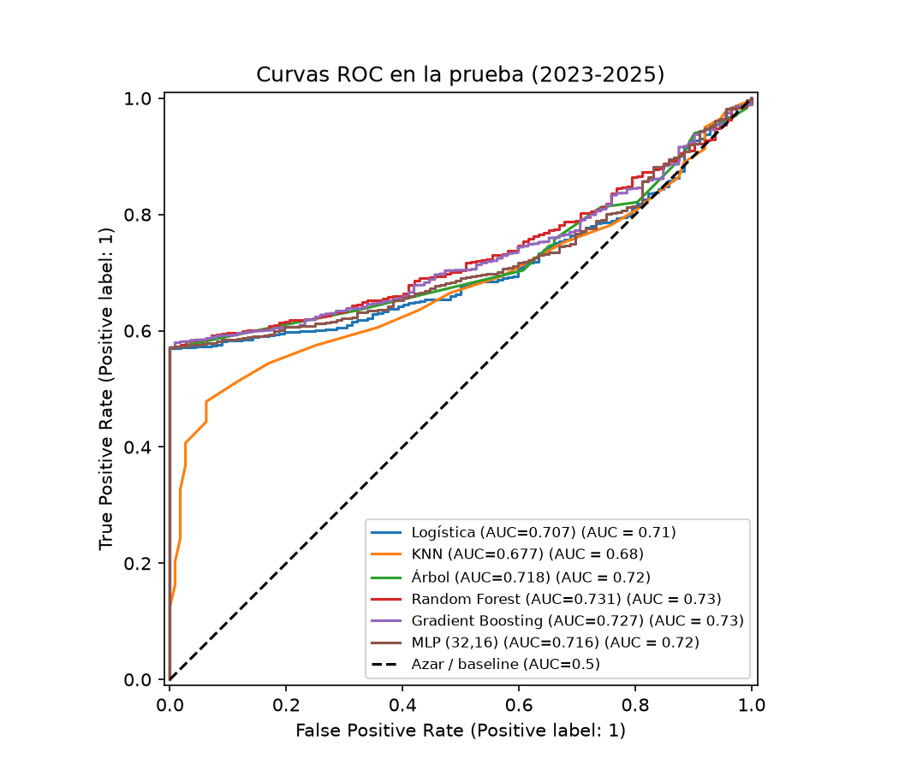

# Road Accidents in Medellín: What Predicts a Severe Crash?

Unsupervised and supervised learning on **657,755 road incidents** (2008–2022) from Medellín's Secretaría de Movilidad. Two questions, one dataset:

- **Where and when do incidents concentrate?** (clustering)
- **Can we predict from the report alone whether someone was hurt, to decide if an ambulance should go right away?** (classification)



## Key findings

1. **The data changed under our feet.** The share of incidents with victims is stable at ~0.55 until 2022, then jumps to **0.996 in 2023**: the source stopped recording property-damage-only incidents. Testing on those years would have given a trivial model 99.8% accuracy, so I modeled 2008–2022 only.
2. **The incident type explains most of the severity.** Pedestrian hits and occupant falls almost always have victims. Collisions, the hard case, only ~40%. The class alone reaches an AUC of 0.79; hour, day and location bring it to 0.84.
3. **The model barely helps where it matters.** Inside collisions the AUC is only **0.60**. A simple rule ("dispatch for any class other than collision") catches ~59% of victims with under 1% false alarms.
4. **The decision depends on a cost assumption.** If an unattended injured person is 5× worse than a wasted dispatch, the best policy is to always dispatch and the model adds nothing. The model only pays off when both errors cost about the same.
5. **Hotspots say where, not how bad.** The 82 DBSCAN hotspots concentrate incidents (the city center holds 25%), but using them as a feature added +0.000 AUC.

## Approach

| | Method | Highlights |
|---|---|---|
| **Part A** | K-means, hierarchical (Ward), DBSCAN | 6 time-of-day profiles; DBSCAN with haversine distance (150 m); weak structure (silhouette ≈ 0.15), reported honestly |
| **Part B** | Logistic regression, KNN, tree, Random Forest, Gradient Boosting, MLP | Temporal split (train 2008–2020, test 2021–2022); `Pipeline` to avoid leakage; threshold chosen by cost with cross-validation, never on the test set |

**Recommended model: logistic regression.** Test AUC 0.835 against 0.840 for Gradient Boosting, the smallest train-test gap (0.010), 16× faster, and explainable through odds.

| Model | CV AUC | Test AUC |
|---|---|---|
| Logistic regression | 0.843 | 0.835 |
| Random Forest | 0.848 | 0.839 |
| Gradient Boosting | 0.848 | 0.840 |
| KNN | 0.811 | 0.800 |

## Run it

```bash
pip install pandas numpy scikit-learn matplotlib seaborn
```

1. Download `Fatal_Road_Traffic.csv` from [Mendeley Data](https://doi.org/10.17632/r6g5dfnpgh.1) (CC BY 4.0) and put it next to the notebooks.
2. Open `Parte_A_Accidentalidad_Medellin.ipynb` (clustering) or `Parte_B_Clasificacion_Medellin.ipynb` (classification) and **Run All**.

```
├── Parte_A_Accidentalidad_Medellin.ipynb
├── Parte_B_Clasificacion_Medellin.ipynb
└── outputs/            # figures and tables
└── poster/            # final presentation 
```

## Limitations

The cost ratio is an assumption (no real costs available), the incident class is assumed known at report time, and the test years follow the training years, so the train-test gap mixes overfitting with drift. Feature importance is not causation.

